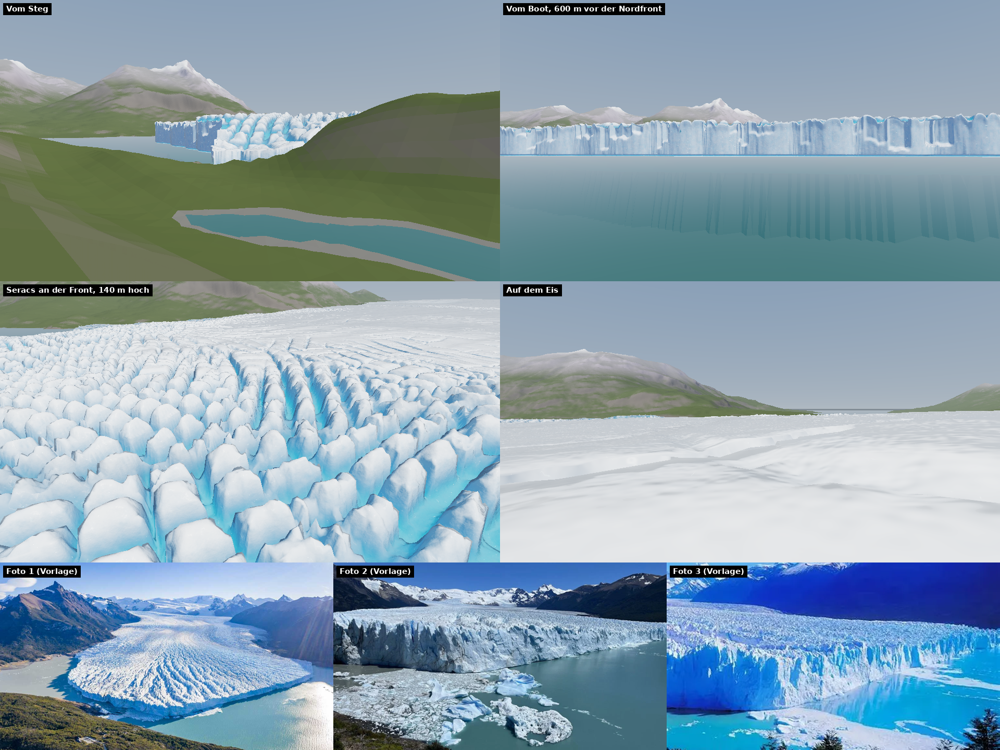
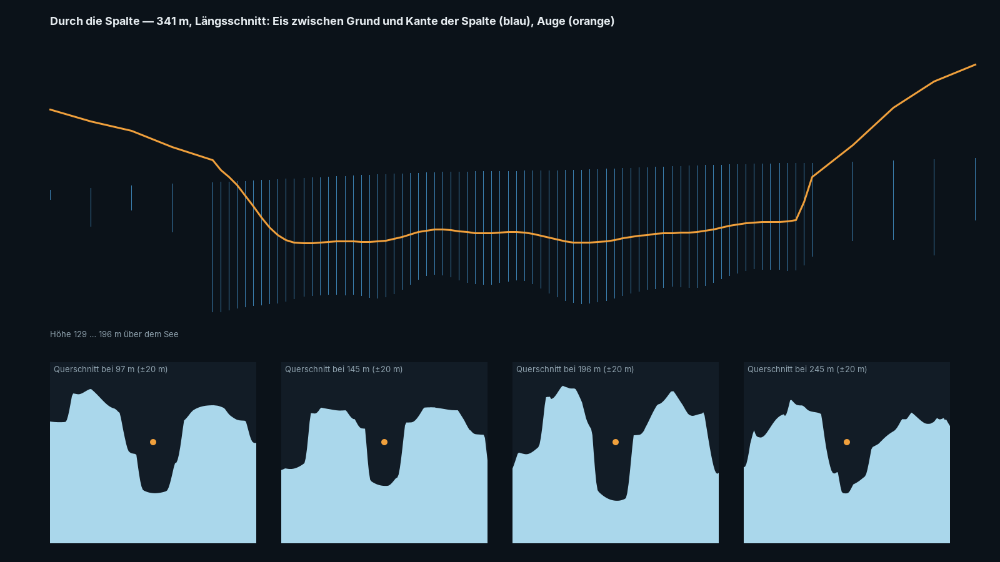
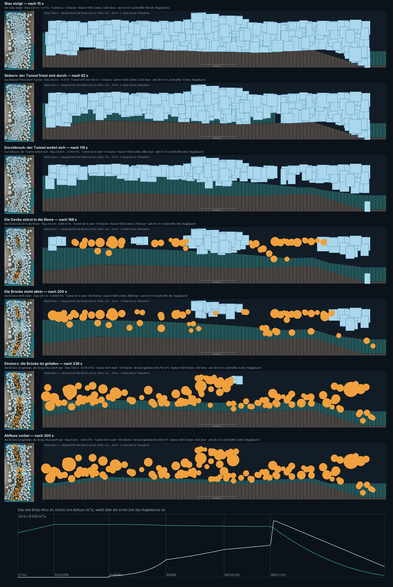
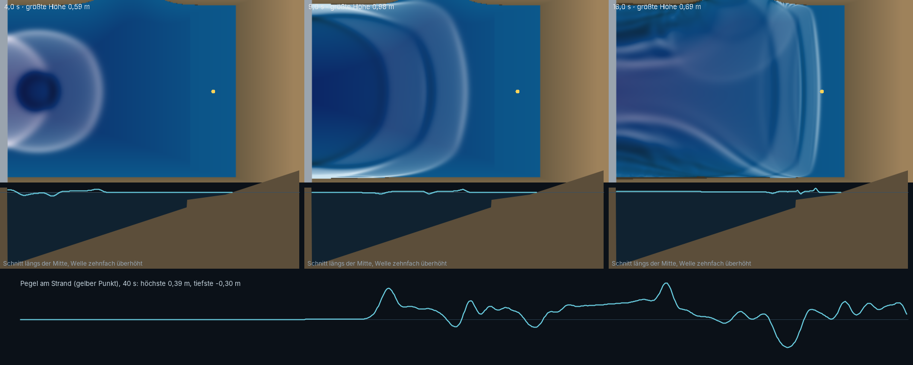
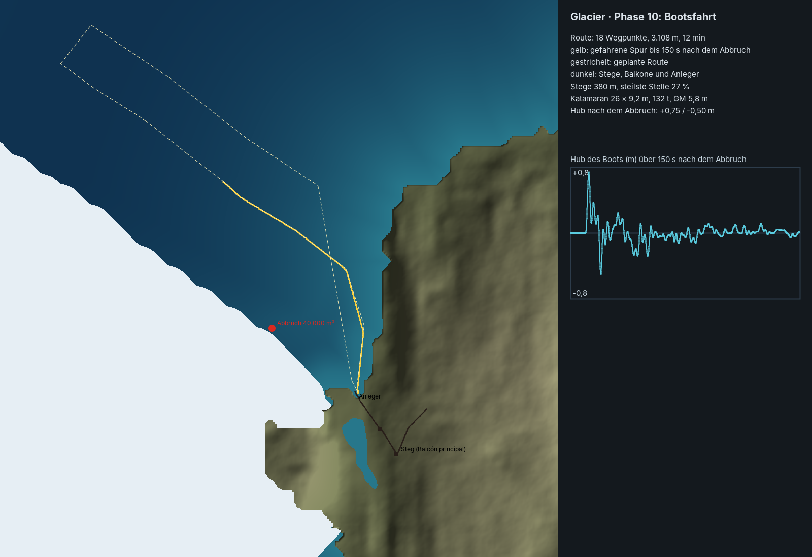
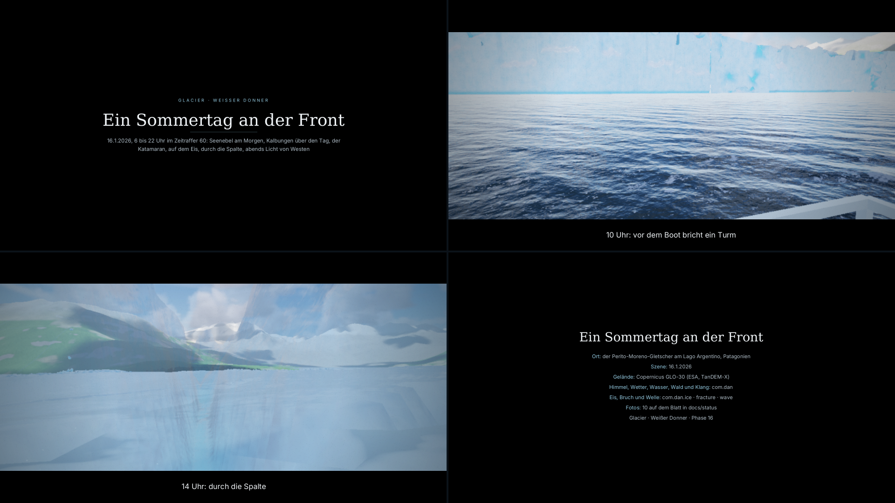
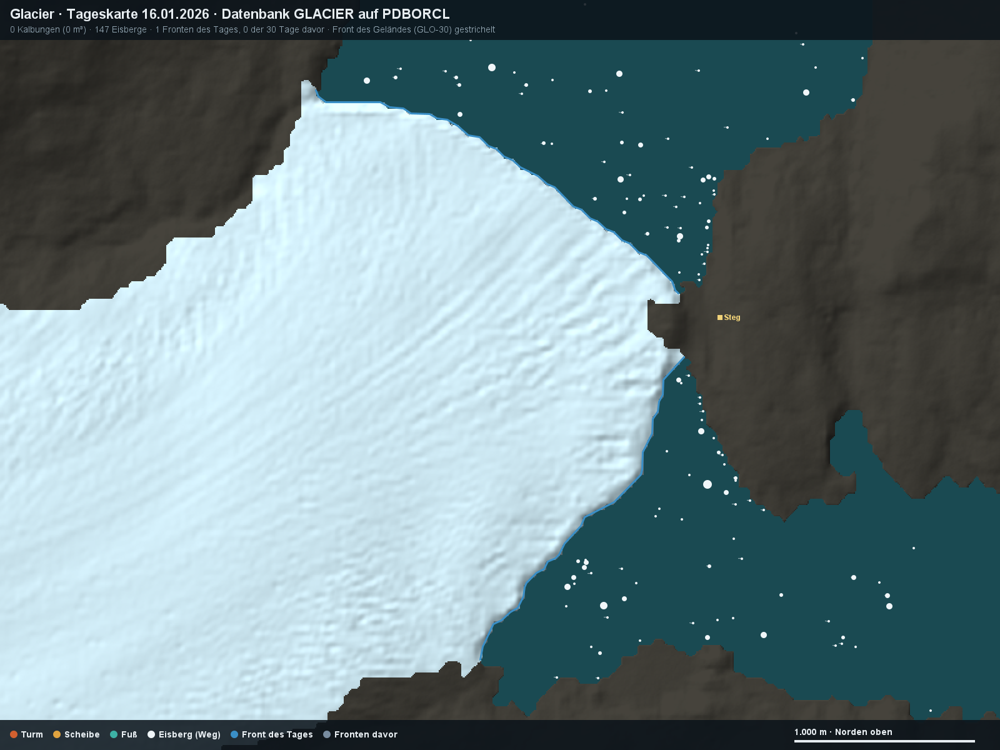

# Glacier – Weißer Donner

Ein Gletscher, der ins Wasser kalbt: der Perito Moreno am Lago Argentino als 3D-Echtzeitszene. Die Front steht 74 m hoch über dem See, alle paar Minuten knackt es, ein paarmal am Tag bricht ein Turm aus der Wand, stürzt ins Wasser und schickt eine Welle über den Kanal, die an den Stegen aufläuft.

Glacier ist die Fortsetzung von Lighthouse und Haithabu mit denselben Packages für Himmel, Wetter, Wasser, Gischt, Wald und Klang. Neu sind vier Packages, die jede Szene brauchen kann:

- `ice`: Eis als Material und Körper
- `fracture`: Bruch und Starrkörper
- `wave`: eine Welle, die läuft
- `kino`: Regiebücher wie im Kino

Jedes Package folgt demselben Vertrag: Der Kern braucht nur Java 21, `gl/` dazu JOGL, `demo/` dazu FStyle. `check-packages` übersetzt jedes Package einzeln und läuft nach jedem Übersetzen.

**Stand: Phase 16 von 16, Schliff.** Die Szene hat Gelände, Himmel und Wetter, Eis und Gletscher, Bruch, Kalbung, Welle, Eisberge, Leben, das Jahr, Klang und den Eisdamm, der bricht. Dazu kommen drei Regiebücher, die Chronik in der Datenbank und jetzt der Kinomodus, der Dauerlauf, die Verknüpfung und die Quellenliste. Plan und Fortschritt stehen im Artefakt „Glacier Werkbuch“, die Statusbilder in `docs/status/`.

## Bilder

| | |
|---|---|
|  |  |
| Fahrt „Durch die Spalte“ (Phase 14) | Die Ruptura: der Eisdamm bricht (Phase 13) |
|  |  |
| Die Welle nach einer Kalbung (Phase 8) | An Bord des Katamarans (Phase 10) |
|  |  |
| Kinomodus: Vorspann, Untertitel, Überblendung, Abspann (Phase 16) | Tageskarte aus der Chronik, dieselbe Karte wie in QGIS (Phase 15) |

## Die Packages

| Package | Inhalt | Stand |
|---|---|---|
| `com.dan.ice` | Eis als Material (Beer-Lambert, Blasen, Risse), als Gletscher (Spalten, Türme, Front, Eisberge) und als Eisdamm | neu, Phase 4–5, 13, 16 |
| `com.dan.fracture` | Zellen, Spannung, Risse, Starrkörper mit Stößen; kennt kein Eis ([README](src/com/dan/fracture/README.md)) | neu, Phase 6 |
| `com.dan.wave` | Flachwasser auf zwei Gittern: Einschlag, Lauf, Auflaufen, Reflexion | neu, Phase 8 |
| `com.dan.kino` | Kinomodus: Balken, Vor- und Abspann, Untertitel, Überblendung, Schwenk, Filmkorn ([README](src/com/dan/kino/README.md)) | neu, Phase 16 |
| `com.dan.sky`, `cloud`, `weather`, `rain`, `fog`, `lightning` | Himmel und Wetter | aus Haithabu |
| `com.dan.ocean`, `spray`, `buoyancy`, `weathering` | See, Gischt, Schwimmen, Nässe | aus Haithabu |
| `com.dan.flock`, `forest`, `ground`, `reed`, `river`, `season` | Leben und Jahr | aus Haithabu |
| `com.dan.soundscape`, `store` | Klang, Datenseite | aus Haithabu |
| `com.dan.glacier` | Die App | [README](src/com/dan/glacier/README.md) |

Abgestellt in `_alt/packages/` (F6 A): `timber`, `smoke`, `hearth`, `herd`, `longship`, `road`, `muster`.

## Rückfluss aus Rungholt

Mit Rungholt (Phase 17, 20.10.2026) kamen die Erweiterungen der gemeinsamen Packages zurück. Alle sind Zusätze oder abschaltbar und stehen auf den alten Vorgaben; Glacier übersetzt ohne Änderung an der App:

- `weather`: der Orkan aus Westnordwest (`Phase.ORKAN`), den die Standardkette nicht erreicht. Die Prüfung der CHECK-Regeln lässt ihn aus, weil Glacier ihn nicht nutzt.
- `ocean`: Strömung als Textur, weicher Rand der langen Welle, Grund außerhalb des Rechtecks, gegen das Kachelmuster. Die lange Welle zählt die Tiefe jetzt unter ihrem eigenen Spiegel; die Fläche taucht am trockenen Rand 1 m unter den Grund statt um die Tiefe.
- `wave`: das Halten der Ränder (`Hold`) und der Dammbruch einer Bresche.
- `fracture`: Klei als Material (`Fracture.klei()`).
- `flock`: die Wattvögel (`Waders`) neben Möwen und Kondor.
- `buoyancy`: die Kogge, `Mesh` mit mehr Formen.
- `ground`: Deich, Salzwiese und Marsch der Nordsee.
- `season`: das Klima Nordfrieslands, milde Nächte (`mild`).
- `soundscape`: Watt, Priel und Sturmnacht (`Wadden`, `Stream`).
- `kino`: nur die README.

## Bauen und starten

- **Projekt:** NetBeans mit Ant und JDK 21. In `lib/` liegen JOGL mit Windows-Natives, `FStyle.jar`, `ojdbc11.jar` und `sdo*.jar`.
- **Bauen und starten:** Clean and Build erzeugt `dist/Glacier.jar` mit `dist/lib`. Danach startet [Glacier.bat](Glacier.bat) die App ohne NetBeans, [Glacier_Konsole.bat](Glacier_Konsole.bat) mit Konsole.
- **Verknüpfung:** [Glacier_Verknuepfung.bat](Glacier_Verknuepfung.bat) legt eine Verknüpfung „Glacier“ mit dem Symbol `Glacier.ico` auf den Desktop und ins Startmenü.
- **Grafik:** OpenGL 4.3 mit Compute-Shadern. Das Ziel ist eine AMD Radeon 680M (2 GB); „Mittel“ hält 60 Bilder/s in Full HD.
- **Datenbank:** Schema GLACIER in PDBORCL, Präfix `GLC_`.
  - `db/USER.sql` legt das Schema an, das Startbild (Knopf „Einrichten“) die Tabellen.
  - Ohne Datenbank speichert die App in `daten/`.
  - Alles Weitere steht in [db/README.md](db/README.md); die Prüfung gegen die Datenbank ist `test/…/DbPruefung.java`.

## Kino

Ein Regiebuch läuft wie im Kino. Starten lässt es sich auf zwei Wegen:

- im Startbild: Regiebuch wählen, „Im Kino“;
- im Block REGIEBÜCHER: Haken „Im Kino zeigen“, dann „Von vorn“.

Bedienfeld, Statuszeile und Titelleiste verschwinden. Die Szene füllt den Bildschirm mit Balken auf 2,39 : 1, und es gibt:

- einen Vorspann mit Titel und Beschreibung,
- Untertitel aus den Stichworten,
- eine Überblendung bei jedem Schnitt,
- einen langsamen Schwenk in stehenden Einstellungen,
- Filmkorn,
- einen Abspann.

Der Ton blendet mit dem Bild. **Esc** beendet das Kino (das Regiebuch läuft im Fenster weiter), die **Leertaste** hält an, **F12** fotografiert mit Balken.

## Prüfen

| Was | Wie | Erwartet |
|---|---|---|
| Packages einzeln | `check-packages` (läuft nach jedem Übersetzen) | alle Packages unabhängig |
| App ohne Fenster | `test/…/Pruefung.java` → Run File, oder `ant pruefung` | „ERGEBNIS: alles in Ordnung“ |
| Datenbank | `test/…/DbPruefung.java` → Run File | „alles in Ordnung“ |
| Dauerlauf | Block TECHNIK → „Dauerlauf 30 min“, oder `-Dglacier.dauerlauf=30` | `docs/status/Dauerlauf_….png` und `.txt`: „Dauerlauf bestanden“ |

## Quellen

Alle Quellen und Befunde (belegt, gemessen, gestaltet) stehen in [docs/QUELLEN.md](docs/QUELLEN.md). Die Datei wird mit `tools/Quellenliste` aus denselben Dateien erzeugt wie die Startdaten der Datenbank. Gelände: Copernicus DEM GLO-30 (ESA).
